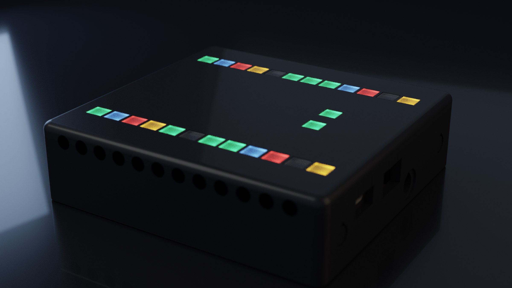
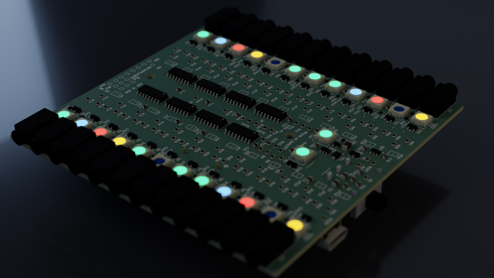
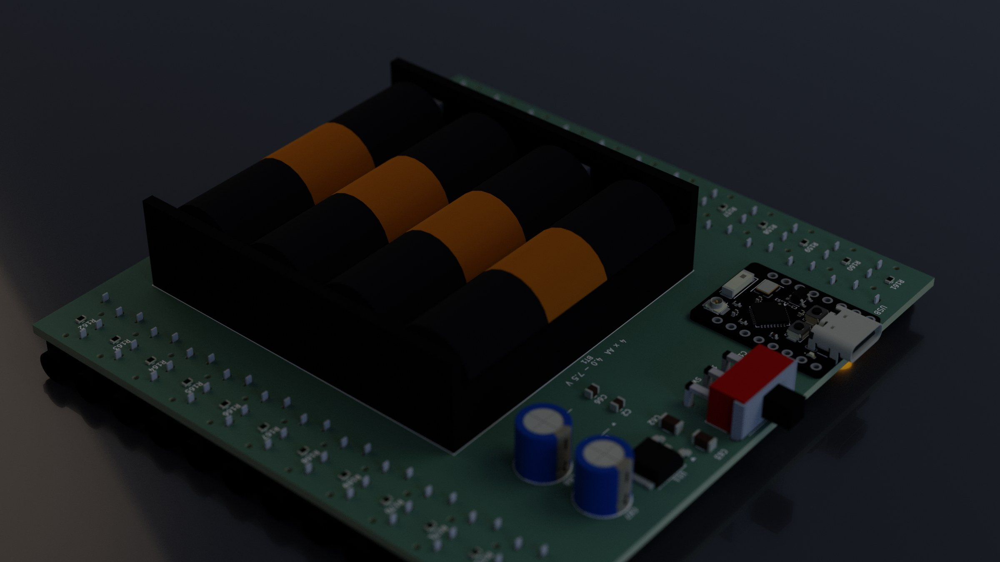
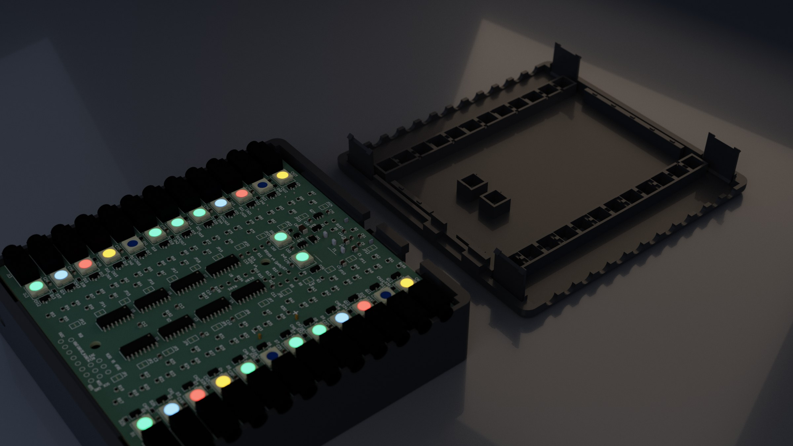
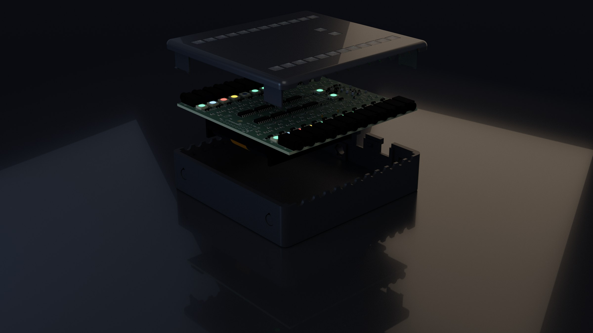
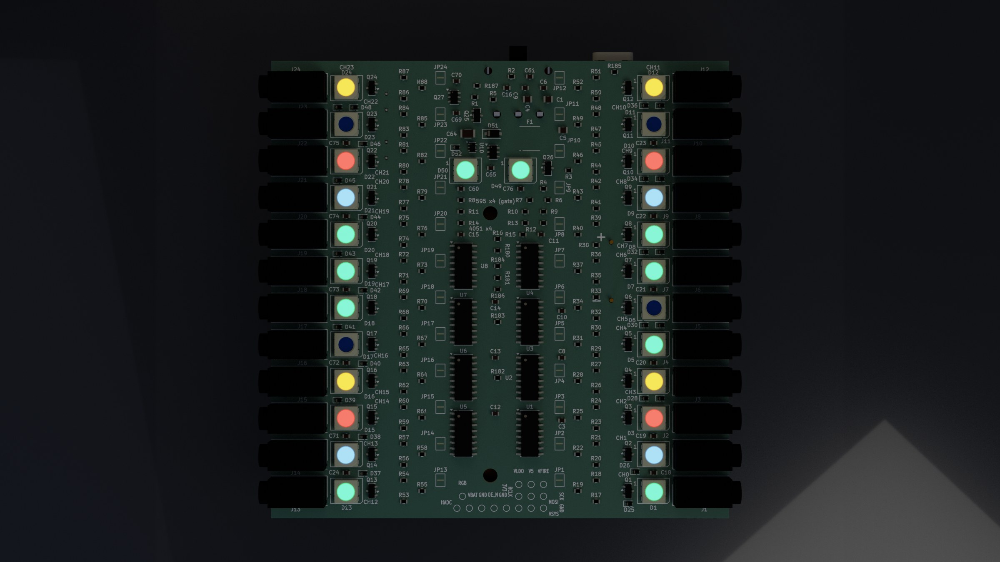
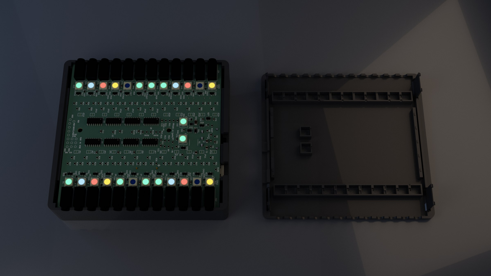
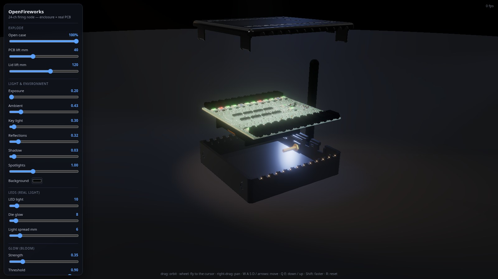
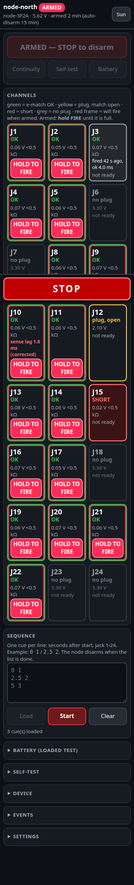

<div align="center">

# 🎆 OpenFireworks

**An open, DIY firework show platform — 24-channel ESP32-C3 firing nodes + a browser-based 3D show planner.**

Plan a pyromusical in realistic 3D, then fire it from a cheap, safe, fully open node.

[](LICENSE)
[](https://tombueng.github.io/openfireworks/)
[](https://tombueng.github.io/openfireworks/studio/)




**[▶ Open the interactive 3D viewer](https://tombueng.github.io/openfireworks/)** ·
**[▶ Open OpenFireworks Studio](https://tombueng.github.io/openfireworks/studio/)** — both run in the browser, no install

</div>

> [!WARNING]
> **Pyrotechnics are dangerous and legally regulated.** This repo is an engineering project, not a licence to
> fire. Obey local law and safety distances. On the node the **slide switch is the physical master-off**; firing
> additionally needs an explicit software arm that powers the firing rail (high-side P-FET) and enables the gate
> drivers — boot-safe disarmed by hardware pulldowns.
>
> **Status 2026-11:** the respin-3 hardware is ordered but not yet built or tested; the firmware has never run on
> a board. Do not connect live e-matches before the bench tests in
> [`docs/RESPIN3_BUILD_AND_FIRMWARE.md`](docs/RESPIN3_BUILD_AND_FIRMWARE.md) §5/§6 have passed on your own board.

---

## Gallery

<table>
<tr>
<td width="50%"><br>
<sub><b>The board</b> — 24 channels on 3.5 mm jacks, one RGB status LED per channel</sub></td>
<td width="50%"><br>
<sub><b>Underside</b> — 4 × AA holder, ESP32-C3 SuperMini, master switch</sub></td>
</tr>
<tr>
<td><br>
<sub><b>Case opened</b> — the lid flips off; the board drops into the base</sub></td>
<td><br>
<sub><b>Exploded</b> — base · board · lid with 26 clear window plugs</sub></td>
</tr>
<tr>
<td><br>
<sub><b>Top-down</b> — 74HC595 drivers + 74HC4051 continuity muxes between the jack rows</sub></td>
<td><br>
<sub><b>Opened, from above</b> — board in the base, lid inside-up with its window pockets</sub></td>
</tr>
</table>

All renders come straight from the real KiCad board (its exported 3D model) and the generated enclosure —
Blender/Cycles, script [`enclosure/blender/showcase.py`](enclosure/blender/showcase.py).

### Interactive 3D viewer

<a href="https://tombueng.github.io/openfireworks/"></a>

Orbit, fly and explode the real board + enclosure in the browser, with the status LEDs lighting through the
windows: **[tombueng.github.io/openfireworks](https://tombueng.github.io/openfireworks/)** (drag the *Open case*
slider).

### Node web UI



Every node serves its own HTTPS web UI (no cloud, no app): all 24 channels with plug detect, continuity and
fire state, live supply voltages, self-test and battery-under-load results, arming, single-channel fire and
cue sequences. Built mobile first for a cold night outside with gloves: big touch targets, STOP as a
full-width bar at the thumb, press-and-hold to fire, a loud "no connection" banner, a high-contrast daylight
theme and the screen kept awake.

*(Screenshot from the UI mock server with simulated data.)*

<br clear="right">

---

## What's here

| Part | Path | Status |
|---|---|---|
| **24-channel firing node v2** (PCB) | `hw/openfireworks_v2.*`, `tools/` | respin 3 done (3 independent review rounds): ERC 0/0, DRC 0 errors / 0 unconnected / parity 0, fab outputs in `export/fab_v2/`, **ordered** |
| **Enclosure** (3D-printed clamshell) | `enclosure/` | generated from the board's 3D models, fit check PASS, interactive three.js viewer; **print package** (multi-material 3MF plates, fit coupon, settings) in `enclosure/print/` |
| **Node firmware** (ESP32-C3) | `firmware/openfireworks_node_v2/` | safe boot, self-tests, arming state machine, per-channel continuity/plug detect, HTTPS web UI, cue sequences, bench tests — compiles clean, **not yet run on hardware** |
| **OpenFireworks Studio** (3D planner/sim/console) | `web/studio/` | self-contained WebGL app: aerial + ground effects, cinematic cameras, sequencer, music, HD/4K recording, demo show |
| **Docs** | `docs/` | design `docs/RESPIN3_DESIGN.md`; assembly, bring-up + firmware safety rules `docs/RESPIN3_BUILD_AND_FIRMWARE.md`; how to regenerate everything `docs/REPRODUCE.md`; BOM with MPNs `export/fab_v2/openfireworks_v2-bom-full.csv` |

This repository holds the result and the scripts that regenerate it. Not in it: datasheets (copyright of
their makers — look them up by the MPN in the BOM), sourcing data, design reviews and older versions.

## What the node measures and records

Everything below is shown live in the node's web UI and on its LEDs. Values marked *expected* are calculated
for respin 3 and still have to be confirmed on the first board.

**Before firing (disarmed, and again on every arm request)**

| what | how | resolution / limit |
|---|---|---|
| Plug in or not, per jack | 100 kΩ plug-detect resistor on the jack's switch contact, read through the mux | yes / no |
| E-match continuity, per jack | test current from 3.3 V through 100 kΩ, 2-level 74HC4051 mux, one ADC | **classes only:** OK (< 0.5 kΩ) / plug with open match / SHORT / no plug, plus the sense voltage. 1–2 Ω cannot be resolved, so a bad but conducting match reads "OK" |
| Battery, resting | VSYS divider on the ADC | V; arming refused below 4.6 V |
| Battery under load | known LED load (~0.3 A) → voltage drop → internal resistance | R_int and the **predicted fire current**; arming refused below 1.2 A |
| Firing rail dead | VFIRE divider, every mux code, with logic lines held high and LED frames running (T0) | rail must read ≈ 0 V |
| Shift-register chain intact | serial readback of the whole chain (T1) | bit-exact |
| Output-enable barrier works | readback pin on the gate drivers' enable (OE_RB), tests T2/T3 | stuck on/off detected |
| Every firing FET switches, none is stuck on | walking-one with the rail off (T5): the commanded channel must read ≈ 1.05 V | per channel |
| Node health | chip temperature, Wi-Fi clients + weakest RSSI, uptime, watchdog, firmware hash | — |

**During a pulse** (one channel at a time, hardware-timed by the RMT peripheral, ≤ 15 ms)

| what | how | effect |
|---|---|---|
| Dead short on the channel | VFIRE (lag-corrected) at 1.5 ms after the start | **abort**: channel off, rail off, logged |
| Bridge burnt through | VSYS sags ≥ 8 % when the match conducts and recovers to ≥ 97 % when it opens | pulse **ends early**; the actual pulse length is recorded |
| Second barrier really switched | OE_RB must go 0 within 10 µs and back to 1 after the pulse | otherwise FAULT |
| Supply collapse | VSYS < 3.5 V for > 2 ms outside a pulse | disarm |

**After firing**

| what | where |
|---|---|
| Per channel: fired, result (ok / short abort / failed), pulse length, time since | channel tile in the web UI; LED dim white = fired, red blink = aborted |
| Continuity after the shot (open = burnt match) | next scan, disarmed |
| Event log: arm/disarm, every pulse with its result, skipped or late cues, faults, refused requests | web UI + USB console, **last 25 events, in RAM only** |

Not recorded: there is no persistent log, no export of a firing report, no time stamp beyond the node's
uptime (no real-time clock; the phone can set a birth time once), and no per-channel current measurement.

## Hardware limits (respin 3)

- **Not tested yet.** The board is ordered, the firmware has never run on it. Everything here is design intent.
- **One channel at a time.** Pulses are sequential (≈ 6.4 ms per channel incl. the LED update); cues must be
  ≥ 20 ms apart. Two effects cannot fire in the very same millisecond on one node.
- **Fire current comes straight from 4 × AA cells** (internal resistance ≈ 0.6–1.2 Ω): enough for standard
  e-matches, not for many in parallel on one channel. Alkaline cells lose a lot in the cold — **use lithium AA
  below 0 °C**. Only AA cells, never 14500 Li-ion (16.8 V destroys the board). Supply range 4.0–7.5 V.
- **Pulse length** ≤ 15 ms (≤ 8 ms when the battery rests below ~5 V, the hold-up must carry the MCU).
- **Jacks:** PJ-320A contacts are rated 0.5 A continuous; the short fire pulses (several A × ms) are fine by
  design but must pass the 50-pulse endurance test (`docs/RESPIN3_BUILD_AND_FIRMWARE.md` §5) before a show.
- **Continuity is a go/no-go test**, not an ohmmeter (see above); a shorted plug pulls the shared rail, so one
  short reads as "short" on every plugged channel and is reported as one fault.
- **Protection:** PPTC (1.5 A hold) on the battery, TVS on every output. The PPTC alone is too slow for a
  sustained short — the firmware's 1.5 ms short abort is the real protection.
- **No hardware arm key.** Both arm barriers are MCU pins with hardware pulldowns; web arming needs a press on
  the module's BOOT button within 30 s. USB is unauthenticated full control — no laptop on the node during a show.
- **Radio:** one node, its own hidden Wi-Fi access point (2.4 GHz, external antenna), range of a phone hotspot.
  No multi-node link, no time sync between nodes, no LoRa yet.
- **Cue lists live in RAM** (≤ 3600 s, lost on reset); the node auto-disarms after 30 min armed.
- **Weather:** the printed case is splash-resistant at best and the jacks are open. Dew: consider conformal
  coating on the bottom side for night shows.
- **No 5 V LED-rail sense** (the UI shows an estimate); LED current is capped at 0.3 A.

## The hardware node

**One board, 100 × 100 mm, 4 layers (JLCPCB standard stack-up).**

- 🧠 **ESP32-C3 SuperMini** (USB-C for programming only) · 4 × 74HC595 + 4 × 74HC4051
- 🔌 **24 low-side N-FET channels** (AO3400) on **3.5 mm jacks** (PJ-320A, with plug detect)
- 🔋 **4 × AA cells** in an on-board Keystone 2477 holder (alkaline, NiMH or lithium, 4.0–7.5 V) ·
  reverse-polarity P-FET · **PPTC** · slide switch master-off · e-matches fire straight from the cells through
  the channel FET; LDOs for 3.3 V (with hold-up capacitors) and the 5 V LED rail
- 🛡️ **Software arm with two independent barriers**, each on its own MCU pin with its own pulldown: ARM P-FET on
  the firing rail (bled to 0 V when disarmed) + gate-driver output enable (with readback); VFIRE and VBAT
  sensed by the ADC; per-channel continuity through a 2-level mux; ESD TVS on every output
- 🌈 **26 WS2812B status LEDs** (one per channel + 2 heads) on a 5 V LDO rail with a level shifter; any subset
  of channels can be populated (per-channel LED bypass jumper)
- 📡 External 2.4 GHz antenna through the enclosure wall (U.FL → SMA pigtail)
- ♻️ **Reproducible:** schematic, board, routing helpers, fab outputs, enclosure, print plates and renders are
  all generated by scripts — pipeline in [`docs/REPRODUCE.md`](docs/REPRODUCE.md)

## Enclosure

A two-part snap-fit clamshell (PETG), generated with build123d from the board's own 3D model: jack half-holes
in both halves, 26 frosted clear window plugs printed with the second extruder **beside** the lid, print-in-place
release buttons, SMA antenna port. Printing: [`enclosure/print/PRINT_SETTINGS.md`](enclosure/print/PRINT_SETTINGS.md)
(start with the fit coupon on plate 0).

## Firmware

```bash
firmware/build.sh          # bring-up
firmware/build.sh show     # show firmware
firmware/build.sh bench    # bench tests
```

See [`firmware/openfireworks_node_v2/README.md`](firmware/openfireworks_node_v2/README.md) for the safety model, the
LED colour code and the web UI.

## OpenFireworks Studio

Open `web/studio/index.html` in a modern browser (needs WebGL; three.js loads from jsDelivr), or use the hosted
copy: **[tombueng.github.io/openfireworks/studio](https://tombueng.github.io/openfireworks/studio/)**

- ▶ Show runs the demo; add effects from the library at the playhead; drag = orbit, scroll = zoom
- Cameras incl. **drone fly-through**; an **auto-director** cuts between them
- Wind drifts smoke + stars; load your own music; **record HD/4K** to a `.webm` (local only)
- Export/import shows as JSON

## Roadmap (honest)

Rig/box modelling + igniter-port mapping UI + printable setup sheets · browser-DB versioned save · monitoring
console UI + fleet management · production crypto (HMAC/AEAD) · LoRa second radio · product catalog import ·
firing-system export adapters.

## License

MIT — see [`LICENSE`](LICENSE). It covers everything in this repository: software, firmware, hardware design
files (schematic, board, fab outputs), enclosure and documentation. Third-party parts (KiCad library footprints
and 3D models, makers' datasheets, three.js loaded from a CDN) keep their own licenses.
