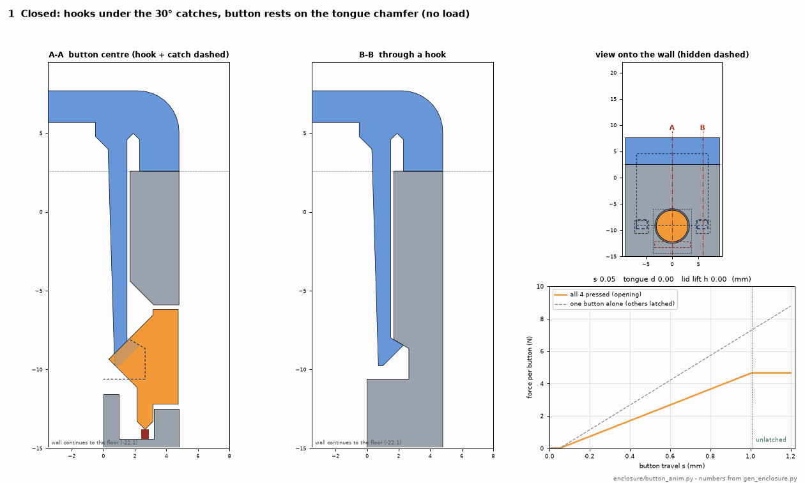
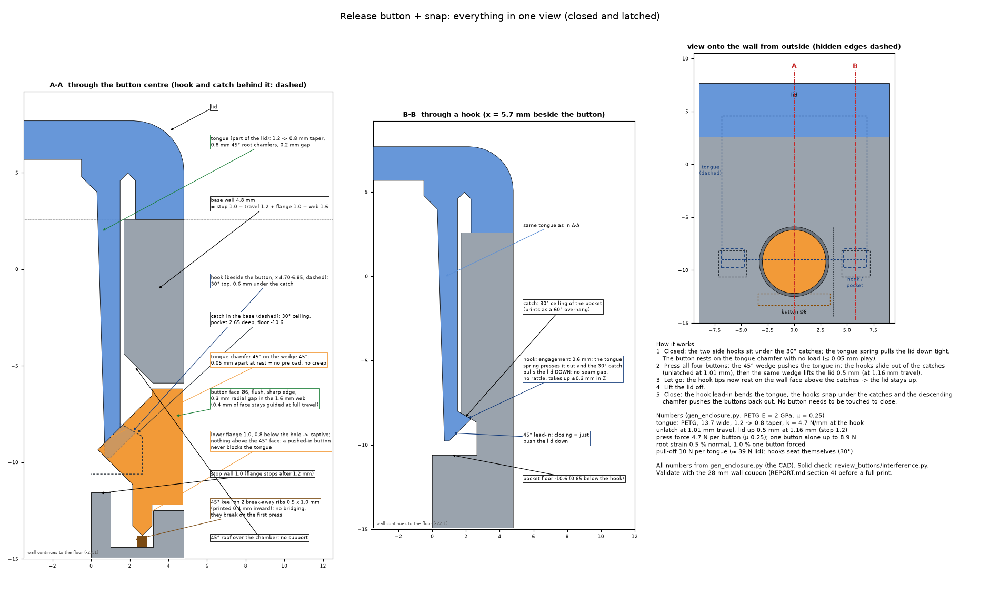

# OpenFireworks enclosure (v3 clamshell)

Two 3D-printed parts, **base** + **lid** (STEP + STL here; `of_assembly.step` = both), generated from
the **real board** — every opening and clearance comes from the parts' KiCad 3D models, not from
footprint courtyards. Check views: `fit_plan.png` (top view) and `fit_sections.png` (sections through
the USB-C, the switch, a jack, an LED chimney, a snap and the whole case).

## Pipeline (all generated — re-run after any board or enclosure change)

| step | command | output |
|---|---|---|
| 1 footprints | `python3 enclosure/extract_board_geom.py` (system python, needs pcbnew) | `board_geom.json` |
| 2 real 3D board | `tools/cadenv/bin/python enclosure/board_model.py` | `viewer/pcb.glb` + `board_3d.json` |
| 3 enclosure | `tools/cadenv/bin/python enclosure/gen_enclosure.py` | `of_base/of_lid .step/.stl`, `of_assembly.step`, `of_sma_pigtail.step/.stl` (bought part, for the check) |
| 4 viewer assets | `tools/cadenv/bin/python enclosure/viewer/make_assets.py` | `viewer/base/lid/windows/leds.glb` |
| 5 fit check | `tools/cadenv/bin/python enclosure/check_fit.py` (~3.5 min) | PASS/FAIL report + `fit_*.png` |
| 5b print package | `tools/cadenv/bin/python enclosure/print/make_print.py` | `print/plate0..2 .3mf/.stl` (print orientation, multi-head layout) — see `print/PRINT_SETTINGS.md` |
| 6 hero renders (GPU) | `blender -b -P enclosure/blender/render.py` | `renders/hero_*.png` |
| 6b README showcase (GPU) | `blender -b -P enclosure/blender/showcase.py` (~20 min) + `node tools/render/shoot_viewer.mjs` | `renders/showcase_*.jpg`, `renders/viewer_open.jpg` |

This runs on a desktop that is in use: run steps 2–6 capped and one at a time, e.g.
`systemd-run --user --scope -q -p MemoryMax=3G -p CPUQuota=200% nice -n 19 <command>`.

## Orientation — the board is turned over, not mirrored
The 24 channel LEDs + 2 status heads are on the board **bottom (B.Cu)** and emit away from it, so the
**B.Cu side is the display face and points UP**; holder, modules, C3 USB-C and switch are on the
**top (F.Cu)** and hang **down into the deep base**. `z = 0` is the display face, the F face is at
`z = -1.6`.

Enclosure frame = looking down on the display face, N wall at the top: **`x_enc = 100 − x_kicad_board`,
`y_enc = y_board`** — a 180° rotation about the board's N-S axis. (Until 2026-11-14 the case was built
in top-view x with B.Cu up, i.e. for the **mirror image** of the board, and the viewer mirrored the
PCB to match, so it *looked* right on screen. Physically the USB-C and switch holes were on the wrong
side of the N wall — and the USB-C hole was also 7.6 mm off, placed on the module's pin-1 anchor
instead of its connector. All fixed; `check_fit.py` guards it.)

## Design
- **Clamshell, parting plane at the jack nose axis (z = 2.58, from the PJ-320A model).** Each 3.5 mm
  jack opening is a half-hole: the lower semicircle in the base, the upper in the lid. **Holes Ø5.2 for
  the Ø5.0 PJ-320A nose = 0.1 mm play** (owner's spec 2026-11-15: parts that pass through a wall get
  only 0.1 mm, `FIT_CLR`). The **W/E walls (1.6 mm = nose 2.0 − board gap 0.4) end flush with the nose
  ends**, so a plug whose body is wider than the hole still seats on the nose. The lid drops straight
  down; nothing slides over the jacks.
- **North wall, two openings** (seen from the front with the display up: the switch west of the
  USB-C):
  - **C3 USB-C — programming only** (respin 3 runs on 4 × AA; the SuperMini's 5V pin is open). Opening 9.14 × 3.39 mm = the receptacle **mouth** (the shell's front 1 mm — its bounding box
    also holds the mounting legs further back) **+ 0.1 mm all round**, inside an outer **plug recess**
    so a standard overmold (12.35 × 6.5) reaches the mouth.
  - **Main switch SW1 (Light Country 5MS1S102AM6QE, right-angle)**: its 3.86 mm square knob points
    north out of the board edge and through the wall; slot 7.22 × 4.06 mm (knob + 2.16 mm travel +
    **0.6 mm left and right** so the lever never rubs, 0.1 mm top/bottom), inside a 14 × 9 mm **finger
    recess** so the knob stands 2.0 mm proud of the recess floor.
  - Both stick into the wall, so the board **drops in from above**: the base wall is notched from
    below each opening up to the parting and the lid carries a filler **tab** that closes the notch
    down to the opening (relieved over the USB-C mounting legs).
  - **2.4 GHz antenna (SMA bulkhead), on the N wall W of the switch** (x 38.0, z −14, below the board;
    between the NW release button and the PPTC F1 that hangs behind the wall at x 34–47; the NE corner is
    taken by a release button): the C3 kit's U.FL → SMA-female pigtail (**~5–7 cm** from the C3's U.FL) is
    pushed through from inside (before the board goes in), its rear hex sits in an **8.3 AF hex pocket of
    an inner pillar** (12 × 2 mm, from the floor — the local wall thickening; it also stops the connector
    turning, so screwing the antenna on never twists the U.FL cable), toothed washer + nut outside in a
    Ø11.2 × 0.8 mm spot face (the thread passes 4.0 mm of the 4.8 mm wall). The round hole with one pointed corner is this antenna hole: Ø6.65 **teardrop** (the
    45° roof prints without support; the washer covers the tip) — not a vent. The viewer shows the kit's
    hinged rod antenna folded up (`antenna.glb`, typical rubber-duck dims).
    The hinged rod antenna then folds up vertical. Dimensions from the Taoglas CAB.011 drawing;
    set `SMA_USE_DFLAT = True` for a D-hole once a flat is confirmed on the
    real part. Plug the U.FL onto the module before lowering the board. **Required, not optional:** the
    SuperMini's ceramic antenna end now lies inboard over the board's ground pour (USB-C points out of the
    north edge), so move its RF 0R to the U.FL position and use this external antenna.
- **Board seat**: the board rests F-down on a perimeter ledge, notched right through to the wall
  wherever a part hangs over it (C3, SW1, F1). The lid's N/S clamp ribs stop 0.4 mm above the
  display face and press it with short **crush bumps** (they take up the board-thickness tolerance, so
  the lid always seats on the walls); the ribs bridge over anything that rises above the display face
  (incl. the leads of F1 and the legs of SW1). Board-to-wall gap 0.4 mm.
- **Light windows**: each LED (WS2812B 5050) has a walled chimney (0.9 mm walls from **0.2 mm above the PCB** — 0.15 over the silk, light-tight, and a
  +0.16 mm thick board still lets the lid seat — up into the
  lid) capped by a 2 mm window pocket for a printed clear plug (`window_plug()`: pocket − 0.10 mm per side, resting on
  a 0.2 mm ledge, with a 0.8 mm spigot into the tube that centres it). **Columns 6.0 × 6.4 mm** (2026-11-22: was
  6.8 — leaves a 1.0 mm web between neighbouring pockets instead of a single 0.6 mm print line; LED body still
  0.7 mm inside) (between the jack bodies
  and the FET column, wall 0.35 mm from the FETs), **heads 6.0 × 6.0 mm** (their chimney walls clear U10,
  the level shifter just north of them).
- **Snaps with release/lift buttons** (4×, N and S walls, **all 12.4 mm in from the W/E case ends** — the
  same spot at every corner; at NE the USB-C plug recess sets the limit). Design adopted 2026-11-21 after an
  independent review (it replaced a first design whose hooks missed their
  pockets, whose lid could not be inserted and whose 0.1 mm print-in-place gaps would weld).

  

  

  - **Section A-A** goes through the button centre, with the side hook and its catch drawn dashed behind it;
    **B-B** goes through a hook. The view onto the wall shows where the two sections lie. Key frames:
    `button_keyframes.png`. Everything is drawn from the generator's numbers (`button_anim.py`).
  - **Closed:** two side hooks per tongue sit 0.6 mm under 30° catches in the base wall. The tongue spring
    pulls the lid down tight (self-seating, no seam gap, no rattle). The button rests 0.05 mm under the
    tongue chamfer, unloaded, so nothing creeps.
  - **Press all four:** the 45° wedge pushes the tongue in; the hooks are free after 1.0 mm of travel, and
    the same wedge then lifts the lid 0.5 mm (at 1.16 mm; the stop is at 1.2 mm). About 4.7 N per button,
    about 8.9 N if one button is forced alone (the other three hold the lid).
  - **Let go:** the hook tips rest on the wall 0.15 mm above the catches, so the lid stays up.
  - **Close:** push the lid down. A 45° lead-in bends the tongue, the hooks snap in and pull the lid down,
    and the tongue chamfer pushes the buttons back out.
  - **Tongue:** part of the lid, 13.7 mm wide between two relief slits, 1.2 → 0.8 mm taper with 45° root
    chamfers, a slot behind it inside the lid wall (invisible outside). Root strain 0.5 %, 1.0 % with one
    button forced. Pull-off about 10 N per tongue (about 40 N for the lid).
  - **Button:** round **Ø6 mm face, flush, sharp edge, 0.3 mm gap** in a 1.6 mm web; 0.4 mm of the face
    stays guided at full travel. The flange behind the web reaches 0.8 mm below the hole, so the button is
    **captive** also with the lid off; inward it stops on a 1.0 mm wall. Nothing of the button sits above
    its 45° face, so a pushed-in button never blocks the tongue.
  - **Printed in place** (base upright): the button is printed 0.4 mm inward of its stop, on a 45° keel
    standing on 2 break-away ribs (0.5 × 1.0 mm); gaps 0.3 mm at the sides and face, 0.4 mm vertically;
    the chamber has a 45° roof. No bridges, no support. Press each button once after printing.
  - **N/S walls 4.8 mm** = inner stop 1.0 + travel 1.2 + flange 1.0 + web 1.6. The antenna bulkhead gets a
    Ø11.2 spot face 0.8 mm deep there, so the SMA thread still passes only 4.0 mm of wall.
  - **Checks:** `gen_enclosure.py` asserts the kinematics, wall budget, captive overlap and that no part
    is in a tongue's or wedge's swing zone; an interference check on the real STEP solids confirmed
    lid ∩ base wall = 0, lid ∩ button at rest = 0, printed button ≥ 0.3 mm from the wall.
  - **Before a full print:** print the fit coupon `print/plate0_fit_coupon.3mf` (checks: `print/PRINT_SETTINGS.md`). If the
    seat is loose, raise `HOOK_PRE` (hook interference); if a button sticks, the print-in-place gaps
    (`FACE_CLR`, `PIPX`, `PIPZ`, `PIP_Y`) are too tight for the printer.
- Outer edges rounded: vertical corners R4, lid top rim R3, base bottom edge R1. **The two edges that meet
  at the parting line are sharp** (owner's spec): closed, the case reads as one block. 2 glue-in weight
  pockets beside the holder (kept below the modules).
- **Envelope 104.0 × 110.4 × 29.8 mm**; lid ceiling 0.6 mm over the tallest display-side part (the jack
  bodies, 5.09 mm); base floor 2 mm under the deepest part (the F1 PPTC / holder, −21.9 mm).

## Fit check (`check_fit.py`) — last result: PASS (2026-11-22, respin-3 board, 6.4 mm channel windows, printed window plugs)
- **Collisions**: every part's surface (~840 k points at 0.3 mm, all 260 real parts incl. the
  DNP/optional ones) tested against the base and the closed lid with **0.2 mm** clearance (parts that
  pass through a wall, outside the board outline: **0.05 mm**, the 0.1 mm-fit rule): **none**. The only
  contact is the board itself, pressed 0.05 mm by the clamp ribs (KiCad's silk/mask over the nominal
  1.6 mm — inside the ±0.16 mm board-thickness tolerance; that clamp is intended).
- **Assembly**: everything that sticks into a wall (jack noses, USB-C, switch) has a free path from
  above; the lid tabs form the top edge of the USB-C / switch openings (0.1 mm above the connector).
- **Openings**: LED bodies ≥ 0.30 mm inside their windows; jack noses 0.10 mm radial gap; USB-C and
  actuator 0.10 mm all round (actuator over its full travel); SMA thread 0.15 mm radial play.

## Verify against physical parts before printing
The check proves the case fits the **3D models**; these model details still need a physical part:
- **PJ-320A jack**: nose Ø5.0 × 2.0 mm past the board edge, axis 2.5 mm above the board (HCTL drawing;
  with 0.1 mm play a ±0.1 mm part deviation already matters — caliper a sample).
- **ESP32-C3 SuperMini (MINI V1)**: USB-C shell ~2.4 mm past the board edge (photo-derived), mouth
  z −5.8..−2.6 under the board.
- **5MS1S102AM6QE**: the model follows the datasheet (p.88-90); check knob size/height on the part.
- **F1 PPTC**: modelled at the maximum envelope (12.0 × 3.5, 18.3 tall + 2 mm standoff).
- **SMA pigtail**: thread Ø6.35 (1/4"-36), flat?, thread length (11.4 assumed), rear hex 8 AF, nut 8 AF.
- Snaps + buttons: print the fit coupon `print/plate0_fit_coupon.3mf` first (`print/PRINT_SETTINGS.md`); hook
  interference `HOOK_PRE`, gaps `FACE_CLR`/`PIPX`/`PIPZ`/`PIP_Y` and the ribs `RIB_W`/`RIB_L` are
  parameters. After printing, press each button once (the ribs break with a small click).
- The lid prints top-down, so the tongues stand upright and their layers carry the bending: print the lid
  walls with ≥ 3 perimeters, hot and with little fan, for good layer bonding at the tongue roots.
- **Print**: PETG/ABS. Base bottom face down; **lid top face down** (the window pockets open toward the
  bed, the chimneys and walls grow upward — no support needed). The 26 clear window plugs print **beside the
  lid** on a second head (`print/plate1_lid_windows.3mf`) and are glued in afterwards (clear UV resin / epoxy,
  no CA). **Print package, settings, fit coupon and tuning: `print/PRINT_SETTINGS.md`.**

## Interactive 3D viewer (browser)
`viewer/` — three.js: the real colored PCB inside the case, per-LED spot lights shining **up** the
chimneys from each lens (aimed in each LED node's own frame), bright emissive dies on the real WS2812B
5050 lenses (one status head pulsing, 4 channels OFF) under **window plugs lit only by their own LED**:
partly see-through (the die is in direct view from ~55° and steeper), partly a diffuser whose soft hotspot
over the die is visible from every angle; "Window frost" moves the balance (0 glass … 1 milky; default 0.5
≈ printed clear PETG) without screen-space blur, so neighbours never bleed into each other and a window
over a dark LED stays dark. Studio spotlights (warm key, cool rim, white top) with light pools on a dark
floor and faint beams ("Spotlights" slider), bloom on the dies only, soft shadows (the lid shades the board), and a panel to open the case, set base/PCB/lid spacing, light, LEDs, bloom,
enclosure colours, window frost, case opacity and glass edges. The slider values in `index.html` are
the defaults.
- Launch: `viewer/serve.sh` (local http server — GLBs need http, not file://) → http://localhost:8000/
- Rebuild assets after a change: pipeline steps 2 + 4.
- `http://localhost:8000/#bench` prints the GPU time per frame (full / LED lights off / bloom off),
  measured synchronously so it is valid even in a background tab.

## Hero renders (Blender / Cycles)
`blender/render.py` imports the GLB assets (the board keeps KiCad's materials; LED dies emissive),
builds studio lighting and renders assembled + exploded hero shots to `renders/hero_*.png`.
`BL_TEST=1` for one quick frame, `BL_SAMPLES=` / `BL_RES=WxH` to tune. GPU-heavy (~10 min for all 13).

Last rendered 2026-11-22 from the respin-3 board and the current case (13 shots, `renders/hero_00…12`).

`blender/showcase.py` reuses that scene setup for the README gallery in the "as printed" look (dark PETG,
frosted windows): bare board top / top-down / underside, the case opened (lid flipped over beside the base),
closed and exploded, 2400×1350 → `renders/showcase_*.jpg`. `tools/render/shoot_viewer.mjs` takes the viewer
screenshot with the case opened (`renders/viewer_open.jpg`; serve `enclosure/viewer` on port 8031 first).
